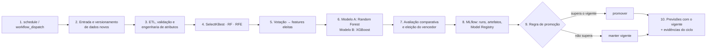

# 🔒 Detecção de URLs maliciosas — Pipeline MLOps agendado (Trabalho N3)

[](https://github.com/pedrosantos2/n3_cybersecurity/actions/workflows/pipeline_mlops.yml)

**Católica de Santa Catarina · Análise Preditiva · Trabalho N3** — Projeto Integrador de MLOps: votação de features, competição de modelos e atualização automatizada.

Classificação multiclasse de URLs (`benign`, `defacement`, `phishing`, `malware`) a partir de atributos léxicos do texto da URL. Um **único workflow agendado** executa, a cada ciclo, todo o fluxo: entrada de dados novos → ETL → três métodos de seleção de features + votação → treino de dois algoritmos (Random Forest × XGBoost) → eleição do vencedor → registro no MLflow → regra de promoção → previsões com o modelo vigente.



Cada execução recebe um **`cycle_id`** e um **`data_version`**, compartilhados por votação, treinos e decisão (no MLflow, nos JSONs de evidência e no manifesto do modelo).

---

## Mapa dos requisitos do enunciado

| Requisito | Onde está | Evidência gerada |
|---|---|---|
| **Etapa 1** – problema, dados, métrica e protocolo definidos antes do treino | [`config/config.yaml`](config/config.yaml) (`problema`, `dados`, `avaliacao`, `particionamento`), notebook 01 | tabela de definição no notebook 01 e no relatório |
| **Etapa 2** – ETL sem vazamento, dados novos sem duplicação | [`notebooks/01_etl.ipynb`](notebooks/01_etl.ipynb), [`src/ingestao.py`](src/ingestao.py), [`src/preprocessamento.py`](src/preprocessamento.py) | `evidencias/<ciclo>/etl_*.csv`, `etl_resumo.json`, [`data/registro_lotes.json`](data/registro_lotes.json) |
| **Etapa 3** – três métodos + votação (no mesmo notebook) | [`notebooks/02_votacao_features.ipynb`](notebooks/02_votacao_features.ipynb), [`src/features.py`](src/features.py) | `votacao_tabela.csv`, `ranking_*.csv`, `votacao_features.json`, run MLflow `02_votacao_features` |
| **Etapa 4** – dois algoritmos, mesmas features e protocolo | [`notebooks/03_treino_competicao.ipynb`](notebooks/03_treino_competicao.ipynb), [`src/modelagem.py`](src/modelagem.py) | `treino_cv_folds.csv`, runs MLflow `03_modelo_a_*` e `03_modelo_b_*` com o mesmo `cycle_id` |
| **Etapa 5** – eleição e promoção controlada | [`notebooks/04_selecao_promocao.ipynb`](notebooks/04_selecao_promocao.ipynb), [`src/promocao.py`](src/promocao.py) | [`models/modelo_vigente.json`](models/), `models/historico_decisoes.csv`, `models/versoes/` |
| **Etapa 6** – MLflow, persistência e rastreabilidade | [`src/rastreamento.py`](src/rastreamento.py), `mlruns/` (versionado) | run pai por ciclo + runs filhos; Model Registry com alias `vigente` |
| **Etapa 7** – workflow único agendado | [`.github/workflows/pipeline_mlops.yml`](.github/workflows/pipeline_mlops.yml) | logs na aba Actions, `gatilho: schedule` em `evidencias/<ciclo>/ciclo.json`, artifact do ciclo |
| **Etapa 8** – previsões e teste integrado | [`notebooks/05_previsoes.ipynb`](notebooks/05_previsoes.ipynb) | `previsoes_teste.csv.gz`, `previsoes_verificacoes.json`, `comparacao_ciclos.csv` |
| **Critério 10** – recurso adicional | monitoramento de drift com alerta: [`src/monitoramento.py`](src/monitoramento.py) | `monitoramento_drift.json`, anotação/issue no GitHub, seção 8 do relatório |
| Relatório técnico | [`src/relatorio_pdf.py`](src/relatorio_pdf.py) → `reports/relatorio_n3.pdf` (regenerado a cada ciclo) | PDF com todas as seções exigidas |

---

## Estrutura do repositório

```
.github/workflows/pipeline_mlops.yml   # ÚNICO workflow (schedule + workflow_dispatch)
config/config.yaml                     # dados, algoritmos, votação, métrica, direção, limiar de promoção
data/raw/                              # lotes recebidos (imutáveis; lote_0001 = dados iniciais)
data/registro_lotes.json               # registro dos lotes (SHA-256, status, ciclo) -> data_version
data/processed/                        # intermediários do ciclo (não versionados)
notebooks/01_etl.ipynb                 # entrada de dados, ETL, atributos, drift
notebooks/02_votacao_features.ipynb    # SelectKBest + Random Forest + RFE e votação
notebooks/03_treino_competicao.ipynb   # Modelo A x Modelo B
notebooks/04_selecao_promocao.ipynb    # eleição, regra de promoção, manifesto
notebooks/05_previsoes.ipynb           # previsões com o vigente, teste integrado, comparação de ciclos
src/                                   # funções reutilizáveis chamadas pelos notebooks
models/modelo_vigente.json             # manifesto do modelo vigente (gerado pelo pipeline)
models/historico_decisoes.csv          # decisão de cada ciclo
models/versoes/vNNNN/modelo.joblib     # todas as versões promovidas (preservadas)
mlruns/                                # MLflow: mlflow.db (SQLite) + artifacts/
evidencias/<cycle_id>/                 # evidências de cada ciclo (+ notebooks executados)
reports/relatorio_n3.pdf               # relatório técnico (regenerado a cada ciclo)
app.py · frontend.py                   # API e painel que servem o modelo vigente
requirements.txt · requirements-app.txt · .python-version
```

`models/`, `mlruns/`, `evidencias/` e `reports/` são criados pelo primeiro ciclo do pipeline.

---

## Dados

- **Fonte:** [Malicious URLs dataset (Kaggle)](https://www.kaggle.com/datasets/sid321axn/malicious-urls-dataset) — 651 mil URLs; licença CC0 (conforme a página do dataset).
- **Download automático:** a fonte é baixada via `kagglehub` (anônimo para datasets públicos) e mantida em `data/fonte/` (fora do Git). Se o download falhar, baixe `malicious_phish.csv` manualmente e salve em `data/fonte/malicious_phish.csv`.
- **Chegada de dados (simulada):** a fonte é embaralhada com semente fixa; o lote inicial (30.000 linhas) já está em `data/raw/lote_0001.csv`. Em cada ciclo, se não houver CSV novo em `data/raw/`, o próximo lote de 5.000 linhas é materializado. Qualquer CSV (`url,type`) colocado manualmente em `data/raw/` também é detectado, validado e incorporado.
- **Versionamento:** cada lote é registrado com SHA-256 em `data/registro_lotes.json`; o `data_version` (ex.: `dv002-ef484fad`) deriva dos hashes dos lotes incorporados. Lotes registrados não podem ser alterados (a ingestão verifica os hashes).

---

## Instalação

Requer **Python 3.14** (ver `.python-version`).

```bash
python -m venv .venv
```

```bash
# Windows
.venv\Scripts\activate
# macOS/Linux
source .venv/bin/activate
```

```bash
python -m pip install -r requirements.txt
```

Para usar a API e o painel: `python -m pip install -r requirements-app.txt`.

---

## Execução local

Um ciclo completo, na mesma ordem do workflow (01 → 05). Os notebooks executados são salvos em `evidencias/<cycle_id>/notebooks/`:

```bash
python -m src.pipeline
```

Dois ciclos seguidos (ciclo inicial + ciclo com lote adicional):

```bash
python -m src.pipeline --ciclos 2
```

Também é possível abrir e executar os notebooks manualmente no Jupyter, **na ordem**. O notebook 01 abre um novo ciclo; os seguintes recusam executar se a etapa anterior do mesmo ciclo não estiver concluída. O servidor MLflow local é iniciado automaticamente se não estiver rodando.

> Execuções locais alteram o estado versionado (`data/`, `models/`, `mlruns/`, `evidencias/`). Para apenas testar, rode numa cópia do repositório ou descarte as mudanças com `git restore`/`git clean` antes de fazer commit.

---

## Execução agendada (GitHub Actions)

O workflow [`pipeline_mlops.yml`](.github/workflows/pipeline_mlops.yml) roda **todo dia às 09:17 UTC** (`cron: "17 9 * * *"`) e pode ser disparado manualmente em **Actions → pipeline-mlops → Run workflow** (`workflow_dispatch`, para depuração). Um único job:

1. faz checkout do repositório — que contém o estado persistente (lotes, registro, modelo vigente, MLflow);
2. instala `requirements.txt` e obtém a fonte (com cache);
3. abre o ciclo (`python -m src.ciclo novo --gatilho <evento>`) e sobe o servidor MLflow;
4. executa em sequência `jupyter nbconvert --execute` dos notebooks 01 → 02 → 03 → 04 → 05;
5. publica o resumo do ciclo e os alertas de drift no resumo do job;
6. regenera `reports/relatorio_n3.pdf`;
7. faz **commit do novo estado** no repositório (`ciclo <cycle_id>: <decisão>`);
8. publica o pacote completo como **artifact** (`mlops-ciclo-<n>`, 90 dias).

Qualquer falha interrompe o job antes do commit: nenhuma promoção indevida é persistida, e o ciclo é marcado como falho no MLflow (o artifact é publicado mesmo assim, para auditoria).

**Pré-requisitos no GitHub:** Actions habilitado no repositório e o workflow na branch padrão (`main`) — agendamentos só rodam na branch padrão. O workflow declara `permissions: contents: write` (commit do estado) e `issues: write` (alerta de drift). Se o push do bot for negado, verifique **Settings → Actions → General → Workflow permissions**.

**Como comprovar o agendamento:** na aba Actions, filtre por evento `schedule`; cada ciclo agendado também registra `"gatilho": "schedule"` em `evidencias/<cycle_id>/ciclo.json`, na tag `gatilho` do MLflow e no histórico de decisões. O GitHub pode atrasar execuções agendadas; por isso o minuto é "quebrado" (`:17`).

---

## Consultar o MLflow

O histórico (todos os ciclos, inclusive os executados no GitHub Actions) está versionado em `mlruns/`. Os artefatos usam URIs relativas (`mlflow-artifacts:/`), então funcionam em qualquer máquina:

```bash
python -m src.rastreamento ui
```

Abra http://127.0.0.1:5000 → experimento **`n3-url-maliciosa`**. Cada ciclo é um run pai `ciclo-<cycle_id>` com os runs filhos `01_etl`, `02_votacao_features`, `03_modelo_a_random_forest`, `03_modelo_b_xgboost`, `04_promocao` e `05_previsoes`. Para filtrar um ciclo: `tags.cycle_id = 'c0002-...'`. O modelo vigente fica em **Models → `url-maliciosa-classificador`**, alias `vigente`.

Equivalente sem o atalho:

```bash
mlflow server --backend-store-uri sqlite:///mlruns/mlflow.db --artifacts-destination mlruns/artifacts --host 127.0.0.1 --port 5000
```

---

## Reproduzir as previsões com o modelo vigente

O bundle versionado contém o pré-processamento, as features eleitas e o estimador; o hash é conferido com o manifesto:

```python
from src.promocao import carregar_vigente

manifesto, modelo = carregar_vigente()
print(manifesto["vigente"]["versao"], manifesto["vigente"]["cycle_id"])
print(modelo.prever(["youtube.com/watch?v=lDnPb7njHUQ", "http://167.114.129.9/bins/dark.arm6"]))
print(modelo.prever_proba(["http://www.ekino-neureut.de/index.php?option=com_xmap&Itemid=28"]))
```

Ou pelo MLflow Model Registry: `mlflow.pyfunc.load_model("models:/url-maliciosa-classificador@vigente")` (recebe o DataFrame de atributos de `src.preprocessamento.extrair_features_lote`).

**API e painel** (servem sempre o vigente e recarregam quando o manifesto muda):

```bash
uvicorn app:app --reload
```

```bash
streamlit run frontend.py
```

API em http://localhost:8000/docs (`POST /predict`, `GET /modelo`, `GET /health`); painel em http://localhost:8501.

---

## Regras de decisão (definidas a priori em `config/config.yaml`)

| Regra | Valor |
|---|---|
| Métrica principal | F1 macro (maximizar) — classes desbalanceadas, mesmo peso para cada classe |
| Partição | hash da URL: teste 15% (só avaliação final), validação 15% (desafiante × vigente), treino 70% com StratifiedKFold k=5 |
| Votação | top-30 por método; eleita com ≥ 2 de 3 votos; mín. 20 / máx. 36 features; desempate pelo rank médio |
| Eleição A × B | maior média de F1 macro na CV; empate (< 0,0005) → menor desvio-padrão |
| Promoção | desafiante supera o vigente em ≥ 0,002 de F1 macro na validação **e** F1 macro ≥ 0,70 **e** recall de cada classe ≥ 0,50; falhas de integridade bloqueiam |

---

## Critério 10 — monitoramento de drift com alerta

- **Problema:** URLs maliciosas mudam rápido; sem monitoramento não se sabe quando os dados novos deixaram de se parecer com os do modelo vigente nem se ele já erra mais.
- **Solução:** o bundle do vigente guarda um perfil de referência das features de treino. A cada ciclo, o notebook 01 calcula o **PSI** por feature do lote novo e a **F1 do vigente no lote novo** (antes do re-treino). Níveis: estável / atenção (PSI ≥ 0,10) / alerta (PSI ≥ 0,25 ou queda de F1 ≥ 0,03).
- **Integração:** métricas e tag `nivel_drift` no MLflow; no workflow, `python -m src.monitoramento alertar` publica anotação `::warning::`, painel no resumo do job e **abre uma issue** em caso de alerta.
- **Evidência:** `evidencias/<ciclo>/monitoramento_drift.json` e seção 8 do relatório, incluindo um controle deliberadamente enviesado (só phishing) que dispara o alerta (PSI ≈ 0,39).

---

## Decisões metodológicas e limitações

- **Viés de coleta tratado no ETL:** cada fonte do dataset grava a URL num formato (benignas quase sem `http(s)://`/`www.`, defacement sempre com `http://`, domínios benignos terminados em `/`). Atributos de formato faziam o modelo aprender a fonte (ex.: `https://www.google.com` → phishing). A URL é normalizada (sem esquema, `www.` e `/` final) antes da extração. A F1 macro caiu de ~0,87 para ~0,76 — menor, porém honesta.
- **Balanceamento de classes:** sem pesos balanceados o recall de phishing ficava em ~0,31; com pesos sobe para ~0,67 com F1 macro equivalente.
- **Limitações:** atributos apenas léxicos; ruído de rótulo na fonte (ex.: páginas de `tools.ietf.org` rotuladas como phishing); domínios curtos sem caminho (como `google.com`) são ambíguos e podem ser classificados como phishing; chegada de lotes simulada; reuso do holdout de validação entre ciclos; crescimento do estado versionado no Git.

---

## Relatório técnico

`reports/relatorio_n3.pdf` é regenerado pelo workflow a cada ciclo a partir das evidências reais. Para gerar localmente:

```bash
python -m src.relatorio pdf
```

Os nomes dos integrantes vêm de `projeto.integrantes` em `config/config.yaml`.

---

## Solução de problemas

| Sintoma | Causa provável / solução |
|---|---|
| `FonteIndisponivel` | sem acesso ao Kaggle: baixe `malicious_phish.csv` e salve em `data/fonte/` |
| `CicloInvalido: etapas obrigatórias não concluídas` | notebooks fora de ordem: execute a partir do 01 |
| `PromocaoBloqueada` | inconsistência de integridade (hash do vigente, `cycle_id`/`data_version`): veja `decisao_promocao.json` no MLflow |
| `LoteAdulterado` | um CSV já registrado em `data/raw/` foi alterado; restaure-o com `git restore data/raw` |
| Push do bot negado no Actions | habilite *Read and write permissions* em Settings → Actions → General |
| Porta 5000 ocupada | altere `mlflow.porta` em `config/config.yaml` e `MLFLOW_TRACKING_URI` no workflow |
